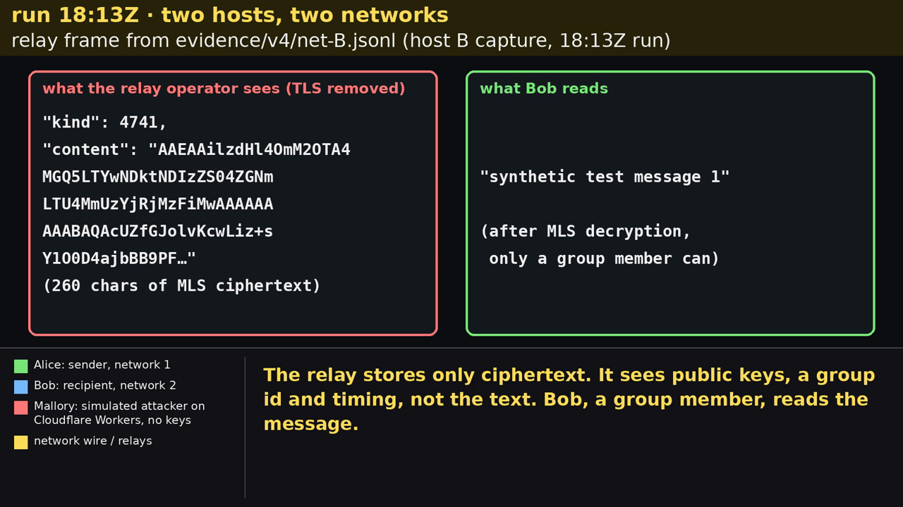

# 🏛️ Styx

**Secure infrastructure for sensitive work.**

> ⚠️ **Experimental software.** Styx is under active development and has **not** completed an
> independent security audit. Do not use current builds for sensitive, high-risk, or life-critical use.

## Latest progress — October 2026

[](https://styxsecure.org/#progress)

▶ **[Watch the 100-second test run](https://styxsecure.org/#progress)** ·
[download the MP4](docs/media/2026-10-m3-test-run.mp4) (2.9 MB, synthetic data, every scene labelled
with its run)

Styx now carries encrypted messages between real machines across the open internet, and keeps their
content out of reach of the infrastructure in between:

- **End-to-end encrypted messaging across networks.** Two machines on different networks exchanged
  messages over three public Nostr relays, each message encrypted by Styx's own MLS engine.
- **The relay operator sees only ciphertext.** With TLS removed using our own session keys, which is
  exactly what a relay operator receives, the content is MLS ciphertext, byte-identical at both
  ends. Only a group member reads the text.
- **Delivery that survives failures.** We cut off a relay and stalled the sender's network; Styx
  queued the message, retried it, delivered it and got the recipient's signed receipt back.
- **An outside attacker got nothing through.** A simulated attacker on a server outside both
  networks, reading everything on the public relays but holding no group key, replayed a message,
  tampered with one, injected one of her own and forged a delivery receipt. Nothing she published
  reached the application.
- **Ahead of plan.** Milestone 1 is [complete](https://github.com/styx-secure/styx/pull/303).
  [Milestone 2](https://github.com/styx-secure/styx/issues/313) is at 31 of 41 tasks, with all
  1,514 tests of its 18 suites passing on its integration branch.
  [Milestone 3](https://github.com/styx-secure/styx/issues/400) started early, and its delivery
  modules are already running in the recording above.

**Why it matters:** whistleblowers, journalists and the people who handle their cases need to work
over infrastructure that anyone can run, without trusting whoever runs it with their words. This
delivery layer is the base for Flegias, a casework channel for whistleblowers and case
handlers, and our Milestone 4 goal.

*Limits, in one line: synthetic data; a prototype test harness, not yet the SDK client (that run is
next); one sample per attack, with the forged-receipt test on a single machine; pre-audit code.*

## Mission

Styx is an open-source, platform-neutral secure application substrate for sensitive workflows over
infrastructure that must not be trusted with plaintext. It combines self-custodied identity,
end-to-end-encrypted collaboration, verifiable state transitions, offline operation, and redundant
delivery. It is not a general-purpose messenger or a replacement for Signal.

It is intended for human-rights and civil-society teams, journalists, safeguarding organizations,
trusted intermediaries, and developers building casework, evidence, coordination, or other
sensitive applications.

The lead product vertical is **Flegias**: a planned case-management application intended to let a
person open and continue a confidential case without providing an email address, phone number, or
ordinary account. This can support abuse, harassment, discrimination, whistleblowing, safeguarding,
and other sensitive casework, but the software cannot replace trained handlers, legal and privacy
review, safeguarding procedures, or emergency channels.

## Where the project stands

- **Built and tested foundations:** an independent Dart ledger and an active JavaScript browser
  stack with a reference MLS chat, Nostr transport, encrypted IndexedDB vault, crypto-worker
  lifecycle, pinned WASM artifacts, fail-closed storage work, and isolated synthetic
  secure-session evidence through the completed Phase B exact-pin proof.
- **Application-protocol evidence now on `main`:** a fully synthetic, transcript-only C0.3
  [conformance corpus](conformance/application-protocol/c03/manifest.json), independent Python and
  JavaScript replay through the [reproduction tooling](tools/causal-flow-simulator/c03/README.md),
  and a closed adversarial mutation registry. This completes corpus construction only. It does not
  establish implementation conformance, protocol completion, or product readiness; C0.3 remains
  `NO-GO` for implementation alignment, demo, product, and sensitive use.
- **Now being built:** authenticated persistence of the MLS session in the encrypted browser vault
  ([Milestone 2](https://github.com/styx-secure/styx/issues/313): 31 of 41 tasks complete or
  approved, including all seven design contracts; 16 components integrated on the
  `m2/integration` branch, where all 1,514 tests of its 18 suites pass; browser and fault-injection
  testing, pending fixes and a closing security review remain), and the SDK and reliable-delivery
  layer, now partly built ([Milestone 3 early lane](https://github.com/styx-secure/styx/issues/400):
  SDK, delivery and preview contracts ratified; queue, retry, multi-relay and receipt modules
  integrated on `m3/integration`). Neither branch is on `main` yet, and integrating the vault into
  the main application is still to come.
- **Not yet a complete product:** completion and ratification of the language-neutral application
  protocol, the SDK client itself, metadata-minimizing case routing, an accountless return channel,
  organizational workflow, distribution assurance, a targeted independent review of a bounded
  high-risk scope, and any separately approved exercise or pilot remain future work.
- **Current technical direction:** Marmot is the preferred compatibility target for the
  MLS-over-Nostr session profile. At the exact OpenMLS, Marmot and MDK revisions recorded in the
  final Phase B report, Styx interoperated with the pinned MDK peer in an isolated synthetic
  direct-MLS profile through durable Welcome join, bidirectional application traffic, sequential
  self-update, the five-past-epoch delivery boundary and bounded two-candidate same-parent
  convergence. This is not general Marmot conformance or product activation. The chat is a
  minimal reference application and interoperability harness, not the product roadmap.

The proposed funded programme preserves the completed bounded secure-session evidence and takes
the project through a conformance-backed Styx application protocol, a supported session adapter,
a reusable SDK and reliable delivery, a text-first Flegias alpha, stronger distribution assurance,
a targeted review of a contractually bounded high-risk scope with remediation and retest, and a
separately gated synthetic or non-sensitive organizational exercise or later controlled-pilot
decision. See the
[project brief](docs/PROJECT_BRIEF.md) for the mission,
evidence, milestones, measurable outcomes, and explicit non-claims. The
[public identity guide](docs/BRAND_IDENTITY.md) defines naming and claim boundaries; the
[dependency-free landing-page source](website/README.md) turns that identity into a reviewable
public surface without deploying it.

This programme description is not a promise of a complete-product audit or authorization for a
live high-risk pilot.

Current transports expose routing, timing, size, and relationship metadata. E2EE also does not
protect a compromised endpoint, a malicious recipient, or a browser build supplied by an origin
controlled by the adversary; the browser profile is weaker against such an adversary (see the
bounded [Phase B verdict](docs/architecture/spikes/2026-08-17-marmot-openmls-phase-b-verdict.md)). No current build offers a universal anonymity guarantee.

> *In Greek mythology, the River Styx marked a boundary and the gods swore solemn oaths upon its waters. The project uses that image to represent explicit trust boundaries in digital systems—not a promise of invulnerability.*

## Dart reference quick start

The following example exercises the independent Dart reference implementation. Current
application-layer work treats the language-neutral protocol and conformance corpus as the
cross-runtime authority before either implementation is extended. This quick start demonstrates
the Dart API; it is not evidence that the Dart stack implements C0.3 end to end.

```dart
import 'dart:convert';
import 'package:styx/styx.dart';

// 1. Create the ledger
final styx = SovereignLedger(
  identity: identity,
  config: const LedgerConfig(
    relayUrls: ['wss://relay.damus.io'],
  ),
  ledgerStore: ledgerStore,
  transport: transport,
  trustStore: trustStore,
  qrPairing: qrPairing,
  remotePairing: remotePairing,
  reKeyProtocol: reKeyProtocol,
  migrationService: migrationService,
  backupService: backupService,
  retentionManager: retentionManager,
  pruneProtocol: pruneProtocol,
  keyPair: keyPair,
);

// 2. Initialize
await styx.initialize();

// 3. Pair via QR
final qr = styx.generatePairingQr();
// ... show QR to peer, scan theirs ...

// 4. Send a transaction
await styx.sendTransaction(
  Uint8List.fromList(utf8.encode('{"amount": 42.50, "desc": "Cena"}')),
);

// 5. Read history
final history = await styx.getHistory();

// 6. GDPR pruning
await styx.requestPrune(targetEventId: history.last.eventId);

// 7. Backup identity (Shamir 2-of-3)
final shares = styx.createIdentityBackup();

// 8. Shutdown
await styx.shutdown();
```

## Dart reference architecture

Styx is structured as a monorepo of composable packages, layered bottom-up:

```
┌─────────────────────────────────────────────────────────┐
│                    styx (façade)                        │
│  SovereignLedger · Pairing · Migration · Backup         │
├──────────────┬──────────────┬───────────────────────────┤
│  transport   │ push_bridge  │      ledger_engine        │
│  Nostr·Email │ FCM/APNs     │  Hash chain · HLC · Merge │
│  Tor·Outbox  │ Privacy      │  Pruning · VectorClock    │
├──────────────┴──────────────┴───────────────────────────┤
│                     storage                             │
│              Drift + SQLCipher (AES-256)                │
├─────────────────────────────────────────────────────────┤
│                    crypto_core                          │
│  Ed25519 · X25519 · SPAKE2 · SHA-256 · BIP-39 · Shamir│
└─────────────────────────────────────────────────────────┘
```

| Package | Description |
|---------|-------------|
| `styx` | Public façade — single entry point with `SovereignLedger` |
| `crypto_core` | Ed25519/X25519 keys, SPAKE2, SHA-256, BIP-39, Shamir SSS |
| `storage` | Drift + SQLCipher encrypted database engine |
| `ledger_engine` | Append-only hash chain, HLC, vector clocks, merge, pruning |
| `transport` | Nostr (primary), Email/IMAP (fallback), Tor (overlay), failover engine |
| `push_bridge_client` | FCM/APNs wake-up with 3 privacy profiles |
| `push_bridge_server` | Stateless Go microservice for push notification bridging |

Current test results and path-aware coverage gates are reported by GitHub Actions; fixed totals are
not used here because the suites change as the protocol and reference implementations evolve.

## Dart reference capabilities

### Pairing
- **QR Pairing** — Direct public key exchange with anti-replay nonces
- **Remote Pairing** — BIP-39 mnemonic → SPAKE2 key exchange → 6-digit Double Check code for MITM detection

### Transactions
- Append-only event chain with SHA-256 hashes and Ed25519 signatures
- Event types: `transaction`, `message`, `config`, `sos`, `rekey`, `merge`, `pruneRequest`, `pruneAck`
- Hybrid Logical Clocks (HLC) for causal ordering across peers

### Offline & Sync
- Full offline operation — events queue in the outbox
- Deterministic merge on reconnect (order by vector clock sum, then lexicographic pubkey)
- Failover transport: Nostr → Email/IMAP → optional Tor overlay

### Privacy & GDPR
- Three push notification profiles: **Balanced** (no dummies), **Private** (Poisson-distributed dummy pushes), **Paranoid** (dummy pushes with real relay connections)
- Bilateral pruning protocol: `PRUNE_REQUEST` → `PRUNE_ACK` → payload removed, hash preserved
- Unilateral pruning for GDPR Article 17 (right to erasure)
- Configurable retention policies with automatic expiration

### Device Migration
- **Re-keying** via Blessing Events (old device signs the new device's public key)
- **Shamir backup** (2-of-3 by default) for identity recovery without re-keying

## Principles

- **No central server of record** — peers hold the authoritative event chain; messages are
  E2E-encrypted and routed by federated relays that cannot read content but do observe some
  transport metadata (not a zero-metadata or "serverless" system)
- **Cryptographic Trust** — Every event is signed, hashed, and chained
- **Sovereign Identity** — Keys are generated locally; storage protections depend on the selected runtime profile
- **GDPR by Design** — Bilateral pruning with hash persistence
- **Offline-First** — Full operation without connectivity, deterministic sync on reconnect

## Development

### Prerequisites

- Dart SDK ≥ 3.10.0 (the locked dependency graph requires it; see `pubspec.yaml`)
- Melos (`dart pub global activate melos`)
- Go 1.21+ (for `push_bridge_server` only)

### Setup

```bash
git clone https://github.com/styx-secure/styx.git
cd styx
melos bootstrap
```

### Commands

```bash
melos run test:all        # Run all tests across all packages
melos run analyze         # Static analysis
melos run format:check    # Check formatting
melos run ci              # Full CI pipeline locally
melos run coverage:check  # Enforce the per-package coverage baseline (90% is a target, not yet met everywhere)

# Single package
cd packages/styx && dart test                    # All tests in one package
cd packages/styx && dart test test/some_test.dart # Single test file
```

### Project Structure

```
styx/
├── packages/
│   ├── crypto_core/           # Identity & cryptography primitives
│   ├── storage/               # Encrypted persistence (Drift + SQLCipher)
│   ├── ledger_engine/         # Event chain, clocks, merge, pruning
│   ├── transport/             # Nostr, Email, Tor, failover, outbox
│   ├── push_bridge_client/    # Flutter push notification client
│   └── styx/                  # Public façade (SovereignLedger)
├── push_bridge_server/        # Go microservice for push bridging
├── test_integration/          # Cross-package integration tests
└── docs/                      # Architecture, security, API, and historical records
```

## License

Styx is **open source**. The licensing model, approved in
[ADR-0004](docs/architecture/decisions/ADR-0004-licensing-strategy.md) and mapped exactly in
[`LICENSING.md`](LICENSING.md) and [`REUSE.toml`](REUSE.toml), is:

- **Original Styx software and documentation:** [`AGPL-3.0-or-later`](LICENSE).
- **Eighteen exact synthetic data paths** (six interoperability vectors from Issue #41, six
  C0.3 transcript-corpus paths approved by Issue #253 and populated by Issue #264, and six SS-0
  corpus paths approved by Issue #291 and populated by Issue #293, all listed in `LICENSING.md`):
  `Apache-2.0`. Only fully synthetic Styx-generated data with no upstream bytes is authorized.
  SS-CORPUS-0 establishes bounded synthetic replay and mutation evidence only; it does not
  authorize an adapter, persistence, SDK, transport, product, demo, deployment or sensitive use.
- **Third-party and vendored material** keeps its upstream licenses and attribution — notably the
  OpenMLS-derived material in `styx-js/vendor/openmls-wasm/` (MIT; that directory also contains
  Styx-authored AGPL scripts and a Styx-modified MIT derivative, classified path by path). See
  [`THIRD_PARTY_NOTICES.md`](THIRD_PARTY_NOTICES.md).
- **Trademarks are separate:** the Styx and Styx Secure names and logos are not granted by the
  software licenses ([`TRADEMARKS.md`](TRADEMARKS.md)).
- **External code contributions remain paused** until separate contributor terms are approved
  ([`CONTRIBUTING.md`](CONTRIBUTING.md)); issues and feedback are welcome.
- Separate commercial terms may be available from the copyright holder; the public AGPL edition
  stays in place regardless.
